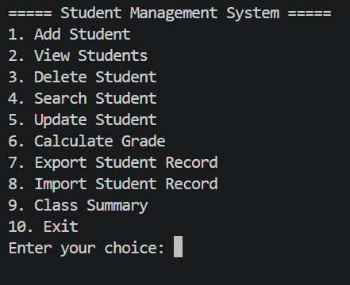

# 🎓 Student Management System

A Python-based Student Management System that uses SQLite to store and manage student records. It also supports CSV import and export for easy data management.

## 🚀 Features

1. Add Student Records
2. View All Students
3. Delete Student Records
4. Search Students
5. Update Student Details
6. Calculate Student Grades
7. Export Student Records to CSV
8. Import Student Records from CSV
9. Class Summary
   - Calculate Class Average Marks
   - Find the Highest-Scoring Student

## 🛠️ Technologies Used

- Python
- SQLite Database
- CSV
- Visual Studio Code

## 📁 Project Structure

```text
student-management-system/
│
├── student.py
├── README.md
├── students.db       (created when the application runs)
└── students.csv      (created during CSV export)
```

## ⚙️ Installation and Setup

### 1. Install Python

Make sure Python is installed on your computer.

### 2. Clone the Repository

```bash
git clone https://github.com/santoshpradhan90061/student-management-system.git
```

### 3. Open the Project Folder

```bash
cd student-management-system
```

## ▶️ How to Run

Run the following command inside the project folder:

```bash
python student.py
```

## 🗄️ Database

The project uses SQLite to store student information permanently. Student records remain available when the application is restarted.

## 📊 CSV Import and Export

- Export student records into CSV files.
- Import student records from CSV files.
- Easily manage and transfer student data.

## 👨‍💻 Author

**Santosh Pradhan**

- GitHub: https://github.com/santoshpradhan90061
- Portfolio: https://santoshpradhan90061.github.io/santosh-portfolio/

## 📄 License

This project is developed for learning and educational purposes.


## 📸 Screenshots

